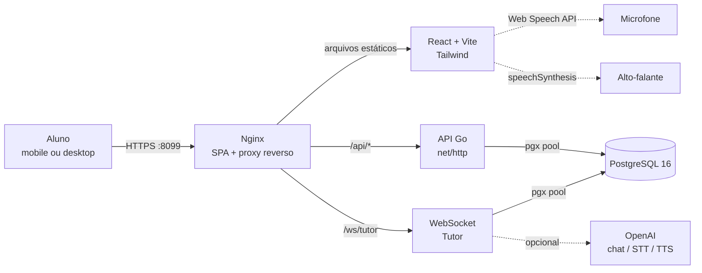
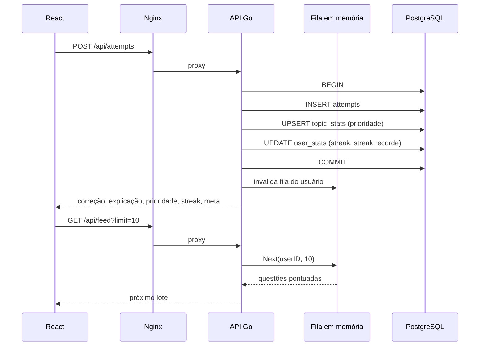
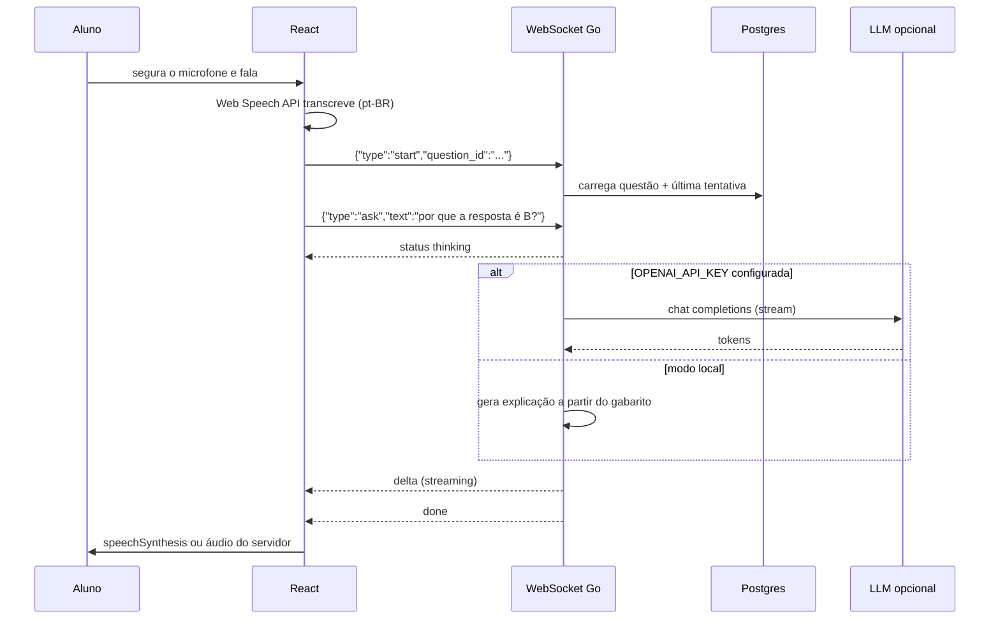

# Arquitetura — Enem Macetado

O Enem Macetado é um app de estudo com feed vertical de questões e tutor por voz. A
arquitetura foi desenhada para latência baixa no gesto mais importante do produto: passar
para a próxima questão e responder.

## Visão geral



Três containers:

| Serviço | Imagem | Responsabilidade |
|---|---|---|
| `web` | Nginx + build do React | Entrega o SPA, faz proxy de `/api` e `/ws` |
| `api` | Go 1.22 estático | Autenticação, onboarding, feed, tentativas, progresso e tutor |
| `db` | PostgreSQL 16 | Usuários, pesos, questões, tentativas e estatísticas por tópico |

O Postgres não é exposto publicamente: em desenvolvimento fica em `127.0.0.1:55432` e, em
produção, o acesso é apenas pela rede interna do Compose.

## Por que Go + fila em memória

O feed precisa responder em poucos milissegundos e cada aluno responde dezenas de questões
por sessão. Consultar e ordenar o banco a cada swipe criaria um gargalo desnecessário.

O caminho escolhido:

1. Ao abrir o feed, a API carrega os candidatos e as prioridades do aluno uma única vez.
2. O score é calculado em memória e a fila fica em cache por 120s por usuário.
3. Cada `POST /api/attempts` grava a tentativa no Postgres e invalida a fila do usuário.
4. O próximo lote é servido do cache, sem `ORDER BY` no banco.

O cache é local ao processo. Com múltiplas réplicas da API, cada réplica mantém sua fila; a
invalidação por tentativa continua correta porque a próxima leitura recarrega do banco. Para
escala horizontal com consistência imediata entre réplicas, o próximo passo natural é trocar
o cache em memória por Redis — a interface `feed.Engine` isola essa decisão.

## Fluxo de uma resposta



A transação garante que tentativa, prioridade e streak nunca fiquem inconsistentes. A
explicação é devolvida só depois da resposta — o feed nunca envia o gabarito para o cliente.

## Fluxo do tutor por voz



O tutor funciona sem nenhuma chave externa: ele monta uma explicação didática a partir do
enunciado, alternativas, gabarito e explicação da questão. Com `OPENAI_API_KEY`, o mesmo
canal passa a usar um LLM com streaming. Detalhes em [VOICE.md](VOICE.md).

## Estrutura de pastas

```
.
├── backend/                 # API Go
│   ├── cmd/api/             # entrypoint
│   ├── internal/            # config, store, auth, feed, tutor, api
│   └── Dockerfile
├── frontend/                # SPA React
│   ├── src/
│   │   ├── components/
│   │   ├── hooks/
│   │   ├── pages/
│   │   └── lib/
│   ├── nginx.conf           # cópia de deploy/nginx.conf no build
│   └── Dockerfile
├── content/questions.json   # seed de questões
├── deploy/                  # nginx, backup
├── docs/                    # esta documentação
├── docker-compose.yml
└── Makefile
```

## Segurança

- Senhas com bcrypt (cost 10); nunca retornadas pela API.
- JWT HS256 assinado com `JWT_SECRET`; expira em 30 dias.
- Queries parametrizadas via `pgx`; validação estrita de bodies e índices.
- CORS restrito às origens configuradas.
- Nginx adiciona CSP, `X-Content-Type-Options`, `Referrer-Policy` e limita o corpo a 12 MB.
- Segredos vêm do ambiente, nunca do repositório.
- O gabarito só é enviado depois de uma tentativa registrada.

Para produção, troque `JWT_SECRET` e a senha do Postgres, ative TLS e não publique a porta do
banco. Veja [DEPLOY.md](DEPLOY.md).

## Decisões e limites

| Decisão | Motivo | Limite conhecido |
|---|---|---|
| Fila em memória | Latência previsível e menos carga no banco | Cache por instância; invalidação via banco |
| Questões seed em JSON | Boot simples e reproduzível | Catálogo inicial pequeno (40 questões) |
| Tutor local determinístico | Funciona offline e sem custo | Menos flexível que um LLM |
| STT no navegador | Sem custo de transcrição e menor latência | Suporte varia (Chrome/Edge são os melhores) |
| Nginx no mesmo container do SPA | Menos peças para operar | Escala do front junto com o proxy |
| JWT stateless | Simples e rápido | Logout não revoga token no servidor |

## Escalabilidade

- A API é stateless para REST; pode escalar horizontalmente atrás do Nginx.
- WebSockets exigem sticky session ou um roteador com hash de conexão.
- Postgres escala verticalmente para a ordem de grandeza esperada; os índices em
  `attempts(user_id, answered_at)` cobrem o histórico e o progresso.
- O próximo gargalo será o catálogo de questões: migrar o seed para uma tabela maior ou um
  serviço de conteúdo não muda o contrato da API.
