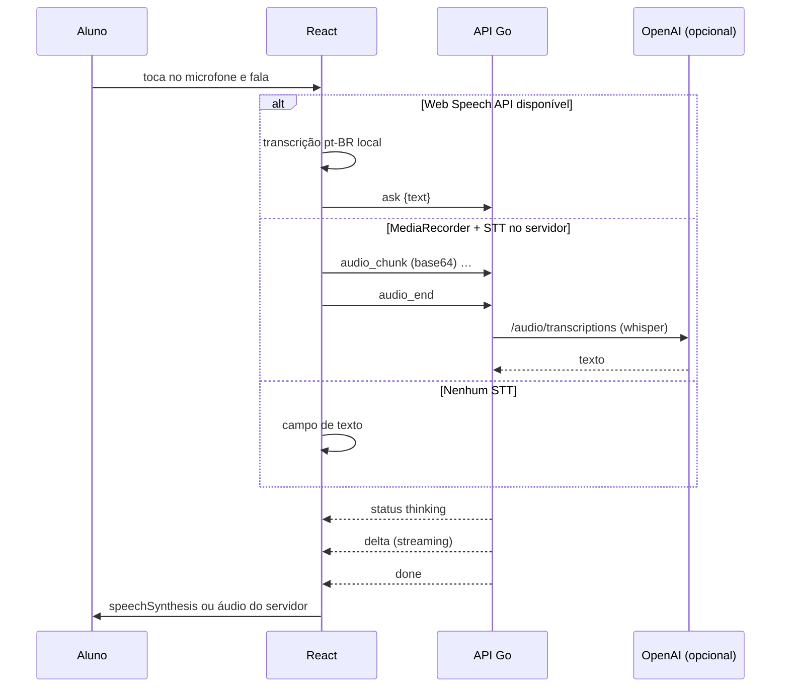

# Tutor por voz — Enem Macetado

O tutor é um canal WebSocket bidirecional entre o navegador e a API. O aluno fala, a
transcrição vira uma pergunta e a resposta volta em texto streaming e, opcionalmente, em
áudio.

## Dois modos, um contrato

| Modo | Quando ativa | O que usa |
|---|---|---|
| **Local** | Sempre que não há `OPENAI_API_KEY` | Gabarito + explicação da questão, templates didáticos |
| **OpenAI** | `OPENAI_API_KEY` definida | Chat completions com streaming; STT/TTS opcionais |

O modo local não é um placeholder: ele produz uma explicação real, em pt-BR, baseada no
enunciado, nas alternativas, no gabarito e na explicação cadastrada. É determinístico e
funciona sem internet e sem custo. Quando há chave, o tutor ganha flexibilidade para
responder perguntas livres, mas qualquer falha da API externa cai de volta no modo local
sem derrubar o socket.

## O ciclo de voz



### Uplink (voz do aluno)

1. **Web Speech API** (`SpeechRecognition`, `lang="pt-BR"`) é o caminho principal. Chrome e
   Edge têm suporte nativo; o áudio nem sai do dispositivo.
2. Se não houver Web Speech mas o servidor anunciar `stt: true` em `ready`, o frontend grava
   com `MediaRecorder`, envia `audio_chunk` em base64 e fecha com `audio_end`.
3. Sem nenhum dos dois, o painel abre um campo de texto — o tutor continua utilizável.

### Downlink (voz do tutor)

1. Se o servidor enviar `{"type":"audio"}`, o frontend toca o MP3 em base64.
2. Caso contrário, usa `speechSynthesis` com uma voz pt-BR, respeitando o botão de mute.
3. Ao fechar o painel, recognition, MediaRecorder, `Audio` e `speechSynthesis` são
   interrompidos e o WebSocket é fechado.

## Configuração

```env
# Provedor opcional (compatível com OpenAI)
OPENAI_API_KEY=
OPENAI_BASE_URL=https://api.openai.com/v1
TUTOR_MODEL=gpt-4o-mini

# Transcrição de áudio no servidor (whisper-1)
STT_ENABLED=false

# Resposta falada no servidor
TTS_ENABLED=false
TTS_MODEL=gpt-4o-mini-tts
TTS_VOICE=alloy
```

- `STT_ENABLED` e `TTS_ENABLED` só têm efeito com `OPENAI_API_KEY`.
- Sem chave, `ready` anuncia `tutor:"local"`, `stt:false`, `tts:false`; o frontend se adapta.
- Para usar outro provedor compatível, troque `OPENAI_BASE_URL`.

## Protocolo

### Handshake

O frontend conecta em `/ws/tutor?token=<jwt>`. A API valida o JWT **antes** do upgrade e
responde:

```json
{ "type": "ready", "tutor": "local", "stt": false, "tts": false }
```

### Contexto

Antes da primeira pergunta, o frontend envia a questão visível:

```json
{ "type": "start", "question_id": "9b2f..." }
```

A API carrega enunciado, alternativas, gabarito, explicação e a última tentativa do aluno.
Essa é a única forma de o tutor saber o gabarito — ele não confia em dados do cliente.

### Pergunta e streaming

```json
{ "type": "ask", "text": "Por que a alternativa C está errada?" }
```

Resposta:

```json
{ "type": "status", "status": "thinking" }
{ "type": "delta", "text": "A " }
{ "type": "delta", "text": "alternativa " }
{ "type": "done", "text": "A alternativa C ignora a taxa fixa..." }
```

Os deltas chegam na ordem e o cliente concatena. `done` carrega o texto completo para
idempotência e para o TTS.

### Áudio

```json
{ "type": "audio_chunk", "mime": "audio/webm", "data": "<base64>" }
{ "type": "audio_end" }
```

Limite de 8 MB por mensagem e 12 MB no proxy. Sem STT configurado, a API responde
`{"type":"stt_fallback"}` e o frontend oferece o campo de texto.

Com TTS habilitado, após o `done`:

```json
{ "type": "audio", "mime": "audio/mpeg", "data": "<base64>" }
```

### Keepalive

O servidor envia `ping` a cada 30s e o cliente responde `pong` (ou envia `{"type":"ping"}`).
Conexões ociosas são encerradas após 60s sem resposta.

## Privacidade

- No caminho Web Speech, o áudio é processado pelo navegador/dispositivo; a API recebe
  apenas o texto.
- No caminho MediaRecorder + whisper, o áudio é enviado à API e repassado ao provedor
  configurado apenas para transcrição; não é persistido.
- O contexto enviado ao LLM contém a questão e a pergunta, não o e-mail ou o nome do aluno.
- Nenhum áudio é gravado em disco pela aplicação.

## Suporte por navegador

| Navegador | Web Speech | MediaRecorder | speechSynthesis |
|---|---|---|---|
| Chrome desktop/Android | sim | sim | sim |
| Edge | sim | sim | sim |
| Safari iOS/macOS | parcial | sim | sim |
| Firefox | não | sim | sim |

Em Firefox, com STT no servidor desabilitado, o tutor abre em modo texto. O produto continua
funcional; apenas o microfone fica indisponível.

## Limites conhecidos

- `speechSynthesis` depende das vozes instaladas no sistema; a qualidade varia.
- Autoplay de áudio pode exigir um gesto do usuário — o painel só toca depois do clique no
  microfone, o que satisfaz a política dos navegadores.
- STT no servidor aumenta a latência; para uso intenso, prefira Web Speech ou um provedor de
  tempo real dedicado.
- O tutor é uma ferramenta de estudo: ele explica o gabarito, mas não substitui a revisão
  teórica.
